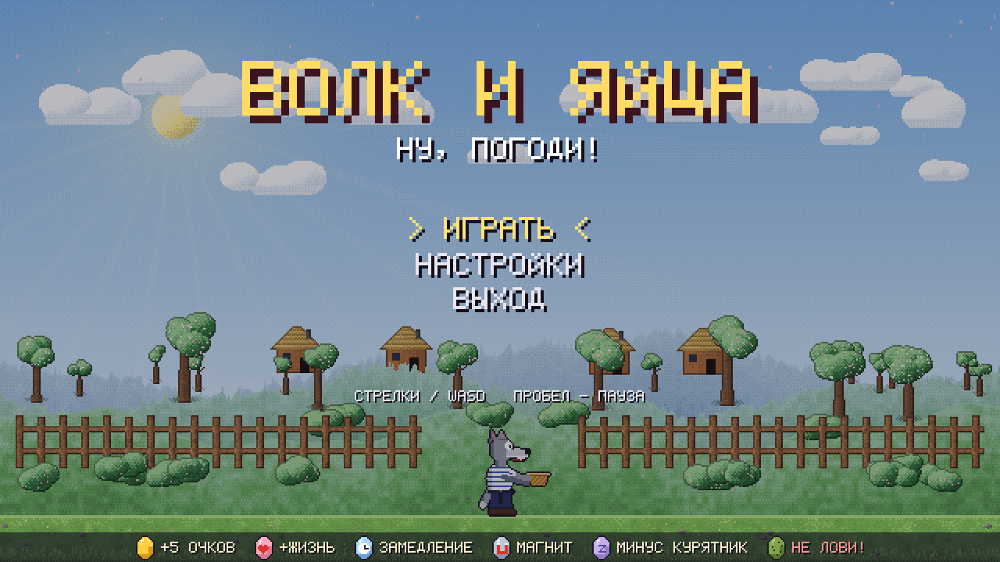
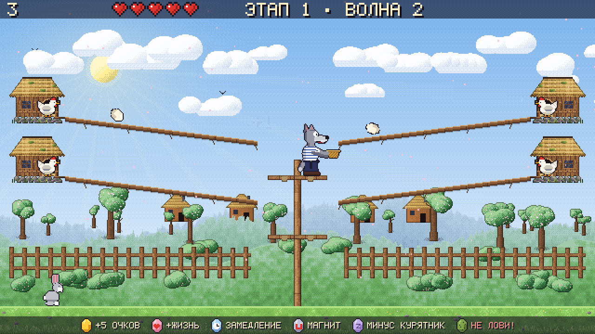
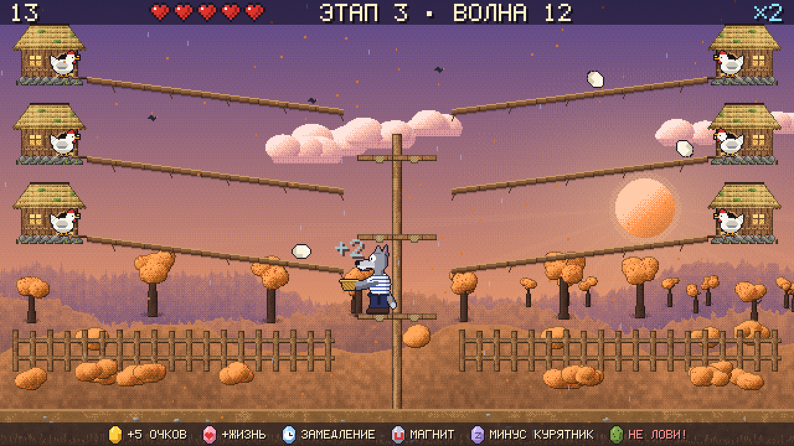
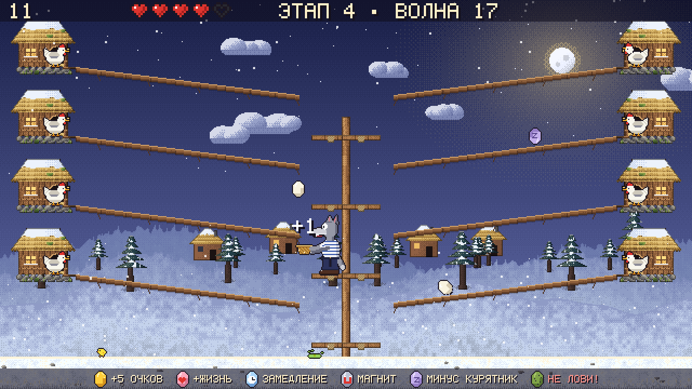

# Волк и яйца — v2

Аркада по мотивам «Ну, погоди!»: ловите яйца корзиной, пока курятников становится всё
больше, а сезоны сменяют друг друга. Вся графика нарисована кодом в стиле плотного
пиксель-арта, весь звук синтезируется на лету — внешних файлов нет.

| | |
|---|---|
|  |  |
|  |  |

## Возможности

- 20 волн в четырёх сезонах (весна, лето, осень, зима), от 4 до 8 курятников.
- Сложность «пилой»: волны с передышками; особые волны «Золотая лихорадка» и «Ураган».
- Спецяйца, комбо-множитель до ×4, заяц, который смягчает промахи.
- Честный спавн: всегда существует способ поймать все обязательные яйца.
- Многослойные параллакс-фоны, погода, анимации, частицы, тряска, hit-stop.
- Своя чиптюн-песня на каждую волну; звуки на каждое событие.
- Рекорд и настройки сохраняются между запусками.

## Требования

- **Python 3.10+** (проверено на 3.13)
- **pygame 2.5+** и **numpy 1.24+** — см. [`requirements.txt`](requirements.txt)
- Windows 10/11. На Linux и macOS должно работать, но не проверялось.

## Установка и запуск (Windows)

1. Установите Python 3.10+ с [python.org](https://www.python.org/downloads/)
   (отметьте *Add python.exe to PATH*) или `winget install Python.Python.3.13`.
2. В PowerShell из папки `v2`:
   ```powershell
   py -m pip install -r requirements.txt
   py main.py
   ```

Если у вас Anaconda, запускайте из *Anaconda Prompt* командами `python -m pip install -r requirements.txt`
и `python main.py` (pygame нужно поставить, numpy там уже есть).

### Параметры запуска

| Параметр | Что делает |
|---|---|
| `--stage N` | начать сразу с этапа N (1–4) |
| `--seed N` | зерно случайности: одинаковое зерно — одинаковая партия и музыка |
| `--debug` | F2 — пропустить волну, F3 — неуязвимость, F4 — следующий этап, счётчик FPS |

## Управление

| Клавиша | Действие |
|---|---|
| Стрелки / WASD | перейти на ярус выше/ниже или на другую сторону |
| Пробел / P | пауза и продолжение |
| Esc | пауза; из паузы — выход в меню |
| R | новая партия после победы или поражения |
| F11 | полный экран |
| Enter | выбор в меню |

## Правила

- Яйцо катится по жёлобу; когда оно доходит до края, волк должен стоять на этом ярусе
  с этой стороны. Иначе яйцо разбивается и отнимает сердце (пока виден заяц — половину).
- 5 сердец на старте, максимум 7. Серия поимок подряд даёт множитель ×2 (5), ×3 (15), ×4 (30).
- Победа — пройти 20-ю волну. Партия длится около 13 минут.

| Яйцо | Поймал | Пропустил |
|---|---|---|
| Золотое | +5 очков × множитель | как обычный промах |
| Тухлое (зелёное) | −1 сердце, сброс серии — **не ловить** | +1 очко |
| Сердце | +1 сердце | ничего |
| Часы | всё замедляется вдвое на 6 с | ничего |
| Магнит | 8 с ловит и с соседнего яруса | ничего |
| Тишина | один курятник молчит до конца волны | ничего |

Подсказка по спецяйцам всегда видна внизу экрана.

## Сохранение

Файл `save.json` рядом с `main.py`: рекорд, лучшая волна и серия, громкость, полный экран.
Можно удалить, чтобы сбросить всё; повреждённый файл игра просто перезапишет.

## Если что-то не так

- **`python` открывает Microsoft Store.** Это заглушка Windows. Используйте `py` из
  установщика python.org или отключите заглушку: *Параметры → Приложения →
  Дополнительные параметры приложений → Псевдонимы выполнения приложений*.
- **Нет звука.** Игра работает и без звукового устройства; проверьте устройство вывода
  и громкость в *Настройках* игры.
- **Картинка размыта или окно маленькое.** Игра масштабирует пиксели целыми множителями;
  разверните окно или нажмите F11.
- **Первый запуск 2–3 секунды.** В это время рисуются сцены всех сезонов и музыка меню.

## Для разработчиков

```powershell
py -m pip install -r requirements-dev.txt
py -m pytest -q                                   # тесты
py tools\simulate.py --runs 24 --step 0.20 --reaction 0.25 --errors 0.05   # баланс ботом
```

| Путь | Назначение |
|---|---|
| `wolfeggs/logic/` | правила игры без pygame: волны, честный спавн, комбо, эффекты, события, бот |
| `wolfeggs/balance.py` | все числа сложности и вероятностей |
| `wolfeggs/gfx/` | кисти и сцена, спрайты, фоны, погода, эффекты, HUD, отрисовка |
| `wolfeggs/audio/` | синтез, звуки, музыка |
| `wolfeggs/screens/`, `wolfeggs/app.py` | экраны и цикл приложения |
| `wolfeggs/save.py` | сохранение |
| `tools/simulate.py` | прогон партий ботом для настройки баланса |
| `docs/design.md` | полная спецификация игры |
